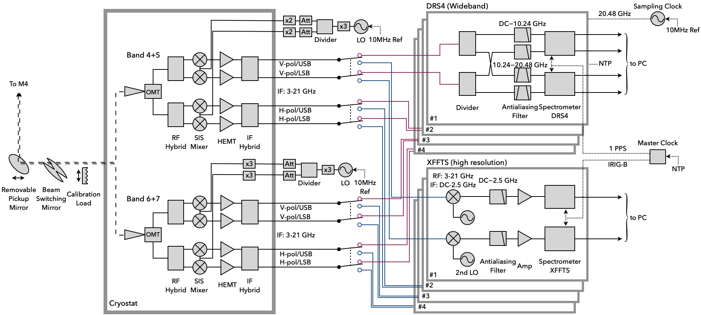

## Specifications

FINER is a dual-polarization, sideband-separating (2SB) SIS receiver system. The table below summarizes the configuration installed for first light and the design goals of the full system.

| General | |
|---|---|
| Number of bands | 2 (one band observed at a time at first light) |
| Number of beams per band | 1 |
| Number of polarizations per band | 2 |
| Number of sidebands per band | 2 (2SB) |

| | Band 4 (first light) | Band 6+7 | Band 4+5 (planned upgrade) |
|---|---|---|---|
| Radio frequency | ≈138–178 GHz | ≈210–351 GHz | 120–210 GHz |
| Intermediate frequency (per sideband, per polarization) | 4–8 GHz | 4–20 GHz | 4–20 GHz |
| Receiver noise temperature (SSB, design goal) | — | 75 K | 45 K |

Measured performance will be reported here after commissioning on the LMT.

## System overview

At first light FINER has two front-end receivers in a single cryostat: a Band 4 MMIC receiver and a wideband Band 6+7 receiver, both developed at NAOJ. A wideband Band 4+5 receiver covering 120–210 GHz is planned as a later upgrade. IF switches select which band feeds the four IF chains, so one band is observed at a time; simultaneous dual-band observation is an option for a future optics upgrade.

**Figure. Block diagram of the full FINER system (design).**

### Optics
The FINER warm optics picks off the beam after the LMT's M4 mirror with a pair of motorized mirrors (the "periscope"), which can be set and stowed remotely. A chopper with a blackbody load is used for intensity calibration. A fast sky chopper for quick position switching is planned in a later phase. The spatial resolution (PSF size) is about 7 arcsec × (frequency / 200 GHz)−1.

### Front-end receivers
The front-end receivers exploit the high critical current density SIS mixer technology developed for the ALMA Wideband Sensitivity Upgrade (WSU) ([Kojima et al. 2017](https://ui.adsabs.harvard.edu/abs/2017ITTST...7..694K/), [2020](https://ui.adsabs.harvard.edu/abs/2020A%26A...640L...9K/); [Kang et al. 2026](https://arxiv.org/abs/2606.25637)), which provides a wide instantaneous frequency coverage.

### Back-end spectrometers
- **Wideband spectrometers (DRS4, ELECS Inc.).** Two DRS4 chassis digitize eight 10.24 GHz-wide basebands with 3-bit, 20.48 GSa/s analog-to-digital converters and provide spectra with 20 MHz resolution ([Hagimoto et al. 2024](https://doi.org/10.1117/12.3018296)). Sideband separation is also performed digitally.
- **High-resolution spectrometers (XFFTS, RPG).** The XFFTS spectrometers of the LMT 2-mm receiver B4R (2.5 GHz bandwidth, 88 kHz resolution) remain available for high-resolution spectroscopy.

### Data and software
FINER is controlled from the LMT Telescope Control System. The data format and the reduction pipeline are being developed together with the LMT team.

## References
See [Publications](../publications/) for the instrument papers.
