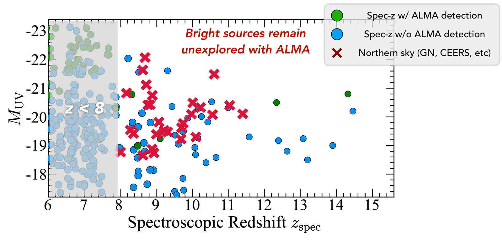
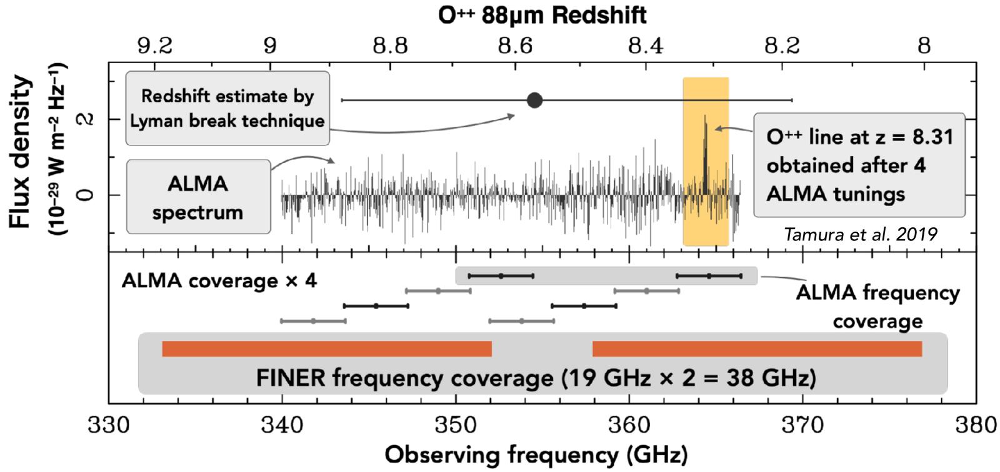
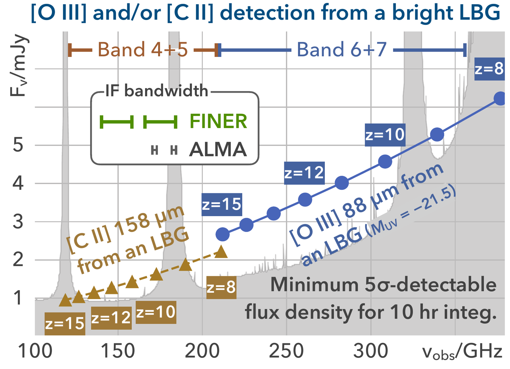

## La formación de galaxias en la primera mitad de la época de reionización

### Antecedentes

El Telescopio Espacial James Webb (JWST) ha encontrado más de un centenar de galaxias candidatas a corrimientos al rojo *z* > 8, cuando el Universo tenía menos de unos 600 millones de años, y ha confirmado espectroscópicamente algunas de ellas hasta *z* ≈ 14. El extremo brillante de su función de luminosidad ultravioleta evoluciona sorprendentemente poco con el corrimiento al rojo ([Harikane et al. 2022](https://ui.adsabs.harvard.edu/abs/2022ApJS..259...20H/abstract)), lo que implica que las galaxias masivas crecieron de forma muy eficiente en poco tiempo. Esto impone una restricción estricta a los modelos de formación de estructuras cósmicas.

Para entender qué impulsa este crecimiento tan rápido, necesitamos espectroscopía que responda dos preguntas:

- ¿Qué tan comunes eran las galaxias brillantes y masivas al inicio de la época de reionización (su densidad numérica)?
- ¿Qué condiciones físicas controlan su crecimiento (metalicidad, estado de ionización y densidad del gas)?

### Líneas de emisión nebular en el infrarrojo lejano

La línea de estructura fina del oxígeno doblemente ionizado en el infrarrojo lejano, [O III] 88 µm, fue propuesta como un trazador poderoso para determinar el corrimiento al rojo de las galaxias más lejanas ([Inoue et al. 2014](https://ui.adsabs.harvard.edu/abs/2014ApJ...780L..18I/abstract)). Las observaciones de esta línea con ALMA revelaron cocientes [O III]/[C II] extremadamente altos, que indican que estas galaxias jóvenes están llenas de gas altamente ionizado ([Inoue et al. 2016](https://ui.adsabs.harvard.edu/abs/2016Sci...352.1559I/abstract)), y mantuvieron hasta 2022 el récord del corrimiento al rojo espectroscópico más lejano obtenido con ALMA ([Hashimoto et al. 2018](https://ui.adsabs.harvard.edu/abs/2018Natur.557..392H/abstract)). Incluso en la era del JWST, a *z* > 9 la línea [O III] 88 µm es tan detectable como las líneas del ultravioleta en reposo observadas con JWST/NIRSpec.

Sin embargo, ALMA, ubicado en el hemisferio sur, no puede observar fácilmente los campos de alta declinación. Muchas galaxias brillantes a *z* > 8 halladas en campos profundos del norte, como GOODS-North y CEERS, aún no se han estudiado en las líneas del infrarrojo lejano (figura 1).

**Figura 1.** Magnitud absoluta ultravioleta frente al corrimiento al rojo espectroscópico de galaxias a *z* > 6. Los círculos verdes y azules son galaxias con y sin detección de ALMA; las cruces rojas son galaxias en campos del norte. Adaptada de [Harikane et al. 2025, ApJ, 980, 138](https://ui.adsabs.harvard.edu/abs/2025ApJ...980..138H/abstract) (código de colores de M. Hagimoto).

### Objetivos científicos principales

Con FINER en el LMT de 50 m en México (latitud 19°N), buscamos:

- identificar espectroscópicamente, mediante [O III] 88 µm y [C II] 158 µm, galaxias brillantes a *z* ≈ 8–15 en el cielo norte, incluidas galaxias confirmadas por el JWST y candidatas fotométricas de cartografiados de gran área como *Euclid* y *Roman*;
- detectar la línea [O III] 88 µm de una galaxia brillante con ruptura de Lyman en una sola noche de observación;
- medir la densidad numérica de galaxias brillantes en la primera mitad de la época de reionización y diagnosticar su medio interestelar.

### Las ventajas de FINER

Una incertidumbre típica del corrimiento al rojo fotométrico de Δ*z* ≈ 1 a *z* ≈ 10 exige una cobertura espectral de más de 30 GHz para encontrar la línea. FINER cubre unos 38 GHz con una sola sintonización, mientras que el ALMA actual necesita cuatro o más sintonizaciones para el mismo intervalo (figura 2). Junto con el 40% del área colectora de ALMA y un sitio a gran altitud (4,600 m), esto ofrece la capacidad de barrido espectral más sensible entre los telescopios milimétricos y submilimétricos del hemisferio norte (figura 3).

**Figura 2.** La línea [O III] 88 µm de la galaxia MACS0416_Y1 a *z* = 8.31 se encontró tras cuatro sintonizaciones de ALMA ([Tamura et al. 2019](https://ui.adsabs.harvard.edu/abs/2019ApJ...874...27T/abstract)). Las barras naranjas muestran el intervalo de frecuencias que FINER cubre en una sola sintonización (19 GHz × 2 bandas laterales).

**Figura 3.** Densidades de flujo esperadas de [O III] 88 µm y [C II] 158 µm de una galaxia brillante con ruptura de Lyman (*M*UV = −21.5) a *z* = 8–15, comparadas con la densidad de flujo mínima detectable a 5σ por el LMT-FINER en 10 horas (gris). El recuadro compara los anchos de banda de FI instantáneos de FINER y del ALMA actual ([Tamura et al. 2024](https://arxiv.org/abs/2406.07975)).

## Otros casos científicos

FINER también ofrece capacidades únicas para una amplia gama de estudios, entre ellos:

- el Sistema Solar (atmósferas planetarias y cometas),
- el medio interestelar y la astroquímica,
- la formación estelar,
- las galaxias cercanas,
- las galaxias lejanas con formación estelar oscurecida por polvo, incluido el seguimiento espectroscópico de galaxias detectadas con TolTEC.

Consulte la [propuesta de FINER (PDF, en inglés)](/files/FINER_Proposal_verA.pdf) para más detalles.
